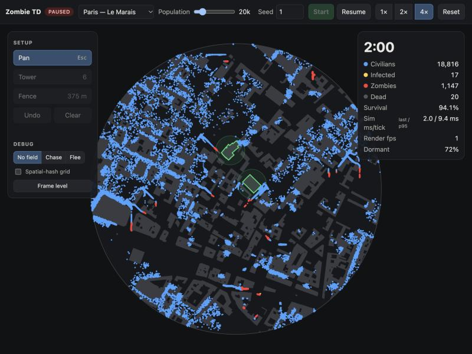

# Zombie TD — proof of concept

A real neighbourhood turned into a zombie-outbreak tower defense. Pick any
place on a street map; its buildings are downloaded from OpenStreetMap. Up to 100,000 agents are simulated at 20 ticks/s by
one Rust core that runs natively (headless tests, scenarios, benchmarks) and
as WASM in the browser.



*Paris Le Marais, wave 6 of 8, 27 s into the outbreak: about 2,900
civilians (blue), a few zombies (red), the garrisons placed over six preps
(green, with their ranges) and corpses (violet). The darker band at the edge
of the disc is the fogged next ring. Right: the wave HUD (saved share
against the 15% line, stamina, supply, deck and discard); bottom: the hand
(tactical cards playable now, prep cards greyed). The "Render fps 2" comes
from the hidden preview pane it was taken in, not from the app.*

## Prerequisites

Only **Docker** with Compose v2 (Docker Desktop on macOS, Docker Engine on
Linux). Tested with Docker 29.6.1 and Compose v5.3.0 on an Apple M1 Pro.

Everything else lives in the dev image (`Dockerfile`):

| Tool | Version |
|---|---|
| Rust (stable, `rust:1-bookworm`) | 1.100.0 |
| wasm-pack / wasm-bindgen | 0.13.1 / 0.2.100 |
| Node.js / npm | 22.23 / 10.9 |
| Python (level tool), requests, shapely | 3.11.2, 2.28, 1.8.5 |
| Web: Vite, TypeScript, deck.gl, MapLibre GL | 6.4.6, 5.9.3, 9.4.1, 5.24.0 |
| Browser tests: Playwright (Chromium, Firefox, WebKit) | 1.61.1 |

`./dev.sh <command>` runs a command in that container with this folder
mounted at `/work`. `./dev.sh` alone opens a shell. Rust build output and
`web/node_modules` live in Docker volumes, so the checkout stays clean.

If you already have Rust (with the `wasm32-unknown-unknown` target),
wasm-pack and Node 22 on the host, the commands below also work without the
`./dev.sh` prefix.

## Commands

| What | Command | Output |
|---|---|---|
| Everything | `./run-all.sh` | Builds WASM, runs all tests (native, WASM, browsers), writes the report, serves http://localhost:5173 |
| Headless test suite | `./dev.sh cargo test --release` | All tests green |
| Headless test suite with debug assertions | `./dev.sh env CARGO_PROFILE_RELEASE_DEBUG_ASSERTIONS=true cargo test --release --workspace` | All tests green with `debug_assert!`s on (release speed, own build cache) |
| Native = WASM hash test | `./dev.sh wasm-pack test --node --release crates/sim-wasm` | WASM reproduces the native hashes and verifies the golden 8-wave run record |
| Verify a run record | `./dev.sh cargo run --release -p sim-headless -- verify run.json --level paris-marais --expect-seed 1` | `verified: …` and the replay summary (exit 0), or `rejected: …` naming the first diverging wave attempt (exit 1) |
| Headless report | `./dev.sh cargo run --release -p sim-headless -- report` | `reports/headless-report.md` and `.html` (charts), raw `reports/*.json` and `*.csv` |
| Web unit tests (Node, Vitest) | `./dev.sh bash -c "cd web && npm ci && npm run test:unit"` | Map blocks, projection, snapshot hash, block cache and loader tests pass (no network, no browser); `cargo test --release -p sim-core --test t6_chunks` checks their Rust fixture. The local profile tests (`web/src/profile/`: collection, decks, payouts, daily caps, crates, tiers, coverage, storage) run in the same suite |
| Browser tests (Chromium, Firefox, WebKit) | `./dev.sh bash -c "cd web && npm ci && npm run e2e"` | A full 8-wave match through the UI (its run record verified headless), the match UI tests and the native = browser hash test pass in all three browsers |
| Browser prototype | `./dev.sh bash -c "cd web && npm install && npm run dev"` | Playable page at http://localhost:5173 |

Useful extras:

- `./dev.sh cargo run --release -p sim-headless -- run --level suburb --pop 20000 --seed 3`
  plays one game headless and prints the population every 10 s.
- `./dev.sh cargo run --release -p sim-headless -- match --level paris-marais --seed 1`
  plays an 8-wave match headless with the starter deck "Civil Defence
  Issue" and a simple scripted defence. In prep it mulligans a hand with no
  armament, plays armaments on spread-out buildings and fences as arcs
  inside the previous ring, and keeps tactical cards. While the wave runs it
  plays tactical cards on the densest group of zombies. It retries a lost
  wave up to 3 times with a different building choice. It prints one row
  per wave attempt: radius, newcomers, civilians at start and end, kills,
  bites, towers, cards played, supply left, game time, tick times and the
  end-of-wave state hash. `--retries`, `--multiplier`, `--no-tactical` and
  `--max-wave-s` (a safety cap; the match itself has no timeout) tune it.
  `ZT_CONFIG=<file>` and `ZT_CARDS=<file>` swap `config.default.json` /
  `cards.json` for balance sweeps; `--level marais-tiled:1300 --fast-forward-to 8 --max-wave-s 150`
  times a real wave 8 at the wave-8 caps (earlier waves won instantly).
  `--record run.json` also writes the match's **run record** (setup, map
  snapshot hash, every action with its tick, the state hash at the end of
  every wave attempt; not with `--fast-forward-to`, which bypasses the
  action log).
- `./dev.sh cargo run --release -p sim-headless -- verify run.json --level paris-marais`
  (or `--level <path to level.json>`, or `--chunks chunks.json --shell
  shell.json` for a match on streamed map blocks: the shell is the level
  without buildings, from the verifier, never the record's) replays a run
  record and checks every action and every wave hash, as the server will
  before paying rewards. `--expect-seed N`, `--expect-deck id,id,...` and
  `--expect-multiplier K` reject a record whose setup is not the one the
  server issued. It prints the replay summary (with the setup and the map
  and shell hashes), or why the run was rejected and at which wave attempt
  it first diverged. `ZT_CONFIG` / `ZT_CARDS` apply as for `match`
  (a record only verifies with the config and cards it was played with);
  `--max-ticks` changes the tick bound, `--quiet` drops the progress lines.
  `node tools/verify-run.mjs run.json --level levels/paris-marais.json` does
  the same with the WASM build (`pkg-node`, see `tools/wasm-bench.mjs`),
  with the same flags.
- `./dev.sh cargo run --release -p sim-headless -- report --quick` makes a
  fast report (2 seeds, no S5, short benchmarks) for iteration. It is marked
  "QUICK MODE".
- `./dev.sh cargo run --release -p sim-headless -- bench --scale --out reports/scale.md`
  runs the wave-8 scale benchmark (1.1 / 1.3 / 1.6 km levels and the tiled
  Marais, 20k–150k agents, native and WASM; about an hour). `--radii`,
  `--pops`, `--level`, `--ticks` and `--skip-wasm` narrow it down.
- `./dev.sh python3 tools/levelgen/levelgen.py --name paris-marais --lat 48.8580 --lon 2.3580 --query-radius 500`
  regenerates a committed level from Overpass (one query; picked places
  stream blocks instead).

### Browser tests

Playwright end-to-end tests live in `web/e2e/` and run in Chromium, Firefox
and WebKit. On the host, install the browsers once, then run them:

```sh
cd web
npm install
npx playwright install chromium firefox webkit   # once per Playwright version
npm run e2e                                      # = npx playwright test
npx playwright test --project=firefox            # one browser
npx playwright test e2e/determinism.spec.ts      # one file
```

Playwright starts its own Vite server on port 5199 (after `npm run wasm`), so
`npm run dev` can stay up. Two environment variables change that:

- `PW_PORT=5288 npx playwright test` uses another port, for example to run a
  second worktree's tests at the same time. If the port is busy the run fails
  at once (`--strictPort`) instead of testing whatever server is there.
- `PW_REUSE=1` reuses a server already running on that port instead. It skips
  `npm run wasm`, so rebuild the WASM yourself first.

The tests need no network: map tiles, search and Overpass are blocked and the
built-in levels are used (every test fails if a request leaves the machine).
The Docker image has the browsers already, and `./run-all.sh` runs these
tests too.

- `match.spec.ts`: a full 8-wave match on Paris Le Marais (seed 2) through
  the UI: wave 1 lost on purpose and retried, a mulligan, keep choices,
  armament building clicks, a fence drag pulled down again with a click,
  a tactical card clicked mid-wave; a test bot (`e2e/bot.ts`, the
  `sim-headless match` strategy) plays the rest at a test-only "as fast as
  possible" speed. The run record is downloaded from the match result panel
  and must verify with `sim-headless verify` (run through `cargo run
  --release`), with every wave attempt's hash equal to the browser's. About
  25 s in Chromium and WebKit, 1–1.5 min in Firefox.
  `node e2e/bot-check.mts 2` plays the same scenario on WASM under Node in
  a few seconds (useful when the balance changes and seed 2 no longer
  clears it).
- `match-ui.spec.ts`: the HUD and the hand, invalid plays and their
  messages (fence too long, building not revealed, too many buildings,
  mulligan after a play, a tactical card in prep), keep marks, a tactical
  card clicked mid-wave, the fog, and pause/speed leaving the state hash
  unchanged.
- `determinism.spec.ts`: runs the native/WASM fixture in each browser and
  compares its hash to `crates/sim-core/tests/fixtures/native_hash.json`.

Opening the app with `?test=1` (for example http://localhost:5173/?test=1)
installs the test hook `window.__zt` (version 2: match state snapshots, the
run record, action helpers that send exactly what the UI sends, and
test-only clock controls; see `web/src/testhook.ts`). Without the flag it is
never loaded.

The generated report is committed in [`reports/`](reports/headless-report.md),
so you can read the results without running anything.

## Playing

1. **Map.** Browse the street map, search an address (press Enter) or click
   to drop a pin, then **Start here**. The dashed circle is the play area:
   1.3 km around the pin, wave 8's ring. The two built-in levels (Paris Le
   Marais, Le Vésinet) start without any download. The last place you
   started is remembered.
2. **Loading.** A picked place's buildings come from OpenStreetMap
   (Overpass) in city grid blocks of about 250 m, shared by every place
   that covers them. The match starts as soon as the blocks of waves 1–2
   are in (about 350 m around the pin: "Downloading the map… n / m
   blocks"); the rest loads in the background while you play, closest ring
   first. If you press **Next wave** before the next ring is loaded, a
   banner says "Loading the next district… n / m blocks" and the wave opens
   as soon as it is; if a block can't be downloaded (Overpass busy or
   unreachable after five tries), it says so with a **Retry loading**
   button. Blocks are cached in the browser (IndexedDB): retries, restarts,
   a new seed and later visits to the same area need no download. A place
   with fewer than 40 buildings in its first blocks is refused ("Pick a more
   built-up spot").
3. **The match.** 8 waves at that place. Wave 1 plays a core of 150 m around
   the pin; each wave reveals a ring around it, up to 1.3 km (a built-in
   level's rings are squeezed into its radius).
   The street map stays on screen with street names hidden; the next ring is
   drawn darker (its buildings and streets stay visible, nothing about the
   people there) and everything past it darker still. The **Seed** box
   starts a new match with another seed. **← Map** goes back.
4. **Prep.** Your deck is the starter deck "Civil Defence Issue" (20 cards).
   Each prep you draw 5 cards (up to 2 kept from the last wave) and get
   supply (shown in the HUD with the deck and discard counts). The hand is
   at the bottom: name, supply cost, kind, rarity. Click a card, then:
   - **armaments** (Rifles, Mortar…): click buildings; the ones you can arm
     are highlighted, the card plays when you have picked as many as it
     equips (or press **Place** with fewer);
   - **fortifications** (fences): drag a line; while dragging the panel
     shows the placed length (parts on buildings are clipped off) against
     the card's limit, and the cost.
   A refused play says why (for example "fence is 512 m, Light fence allows
   400 m"). **Mulligan** (1 supply, once per wave, before playing a card)
   draws a new hand. **Keep** on a card keeps it for the next wave (up to
   2; without a choice the first two stay). Click a fence or a garrisoned
   building to **Repair** it (cost shown) or **Pull it down** (refund
   shown: the full cost and the card back for something placed in this
   prep, half otherwise). Then **Start wave**.
5. **The wave.** The outbreak starts (its locations are hidden). Only
   **tactical** cards can be played now (Grenades, Paratrooper…): click the
   card, then a point. The HUD shows the wave n/8, civilians, infected and
   zombies, the share saved against the red **15%** line, and the
   civilians' stamina: they tire as the wave goes on (zombies don't), so
   stalling punishes itself. **Pause** (Space) and 1× / 2× / 4× only change
   how fast you watch; they never change the outcome.
6. **Result.** A wave is won when no zombies or infected are left, lost when
   fewer than 15% of its civilians are. The panel shows the saved share and
   the supply earned, with **Next wave**, **Retry wave** (same outbreak,
   same draws) and **Restart match**. After wave 8, the match panel shows
   the retries, the civilians saved and a table per wave, and **Download run
   record** saves the run (seed, deck, every action with its tick, the
   state hash after every wave attempt), which `sim-headless verify`
   replays and checks. On a picked place **Download map** saves the map the
   run used (the shell and its blocks) next to it: `sim-headless verify
   run.json --chunks map.json --shell map.json`.

Pan by dragging the map (except while drawing a fence), zoom with the wheel
or the +/− buttons, **Frame level** to re-centre. The debug panel shows the
chase or flee field as a heatmap and the spatial-hash grid.

Colours: civilians blue, infected (1 s before turning) yellow, zombies red
(all with a thin dark rim so they read on the map), garrisons green with
their range, paratroopers and convoys as green dots, fences near-black
turning red as they take damage. A zombie killed by a garrison flashes pale
for 1 s and then stays on the map as a violet corpse.

Speeds: civilians wander at 1.2 m/s and flee at 4.4 m/s; zombies run at
7.5 m/s.

## Results

From the committed [headless report](reports/headless-report.md), generated
on the Apple M1 Pro inside the Docker dev container (Linux VM, one thread).

| Check | Target | Measured | Result |
|---|---|---|---|
| Native p95 tick, 100k agents | ≤ 15 ms | 21.16 ms | **FAIL** |
| Native max tick, 100k agents | ≤ 30 ms | 29.95 ms | PASS |
| WASM (Node) p95 tick, 100k agents | ≤ 25 ms | 26.48 ms | **FAIL** |
| WASM (Node) max tick, 100k agents | ≤ 45 ms | 38.93 ms | PASS |
| Tests (24, incl. native = WASM hash) | all pass | 24/24 | PASS |

**The p95 targets fail since the speed change** (civilians 2×, zombies 3×).
Before it, native p95 was 13.21 ms and WASM 16.63 ms. Faster zombies convert
nearly everyone within the 150 s benchmark and then run in dense columns, so
separation (pushing overlapping agents apart) now takes 59% of the tick:
about 8 ms at 100k, against about 4 ms before. Lowering the scan cap from 48
to 24 only brings native p95 to 17.9 ms, so meeting the target needs a
reworked separation pass (for example a finer grid sized to the 0.6 m
radius).

**Browser, measured before the speed change (Apple M1 Pro, Chrome-based
preview):** at 100k agents the sim kept real time at 9.7 ms last /
18.6–19.3 ms p95 per tick (target: under 50 ms), with no fallback mode.

**Render fps:** the owner checked the HUD's "Render fps" at 100k agents in a
normal browser window and found it smooth. No exact number was recorded.

Scenario highlights (5 seeds each, new speeds): every scenario now ends in a
loss. Without defense, Paris loses half its civilians after about 91 s (S1)
and 90% after about 136 s. Eight central garrisons kill about 183 zombies but
don't change the outcome (S2). The fence ring in S3 is first breached after
10 s. The suburb falls faster than Paris (S4, half lost at 59 s).

## How it works

- **`crates/sim-core`**: the whole game. Level rasterization (2 m cells),
  struct-of-arrays agents, a counting-sort spatial hash, Dijkstra flow fields
  with a bucket queue (chase for zombies; threat and a Brogue-style flee field
  for civilians), dormant civilians far from danger updated 1 tick in 4,
  bites, a 1 s infection, separation, wall sliding, towers and fences.
  Deterministic: PCG32, no trig, index-order iteration, FNV-1a state hash.
  `Match` (`match_.rs`) runs the 8-wave loop on top of `Sim`: rings revealed
  wave by wave, newcomers from the new ring's buildings, per-wave outbreaks,
  fatigue, persistent placements, retry / restart, buildings streamed in
  chunks. Every change goes through `Match::apply(Action)` and `step()`.
  Cards (`cards.rs`, data in `cards.json`) are the player's tools: a 20-card
  deck, a hand of 5 per wave (2 can be kept), supply per wave, one
  mulligan, repair and pull-down. Fortifications and armaments are played
  in prep, tactical cards during the wave.
  Run records (`record.rs`) and the replay verifier: `RunRecord::from_match`
  and `replay(record, map)`; the map snapshot hash is `mapsnap.rs`.
  The browser plays the match through `WasmMatch` since T5.
- **`crates/sim-headless`**: tests support, scenarios S1–S5, benchmarks and
  the report writer (SVG charts, no Python).
- **`crates/sim-wasm`**: wasm-bindgen wrapper with no logic of its own:
  `WasmSim` (the single-wave prototype), `WasmMatch` (the 8-wave match:
  JSON actions in, state and the run record out) and `verify_level` /
  `verify_chunks`.
- **`web/`**: the match runs in a Web Worker on a fixed 20 Hz accumulator,
  stepped only while a wave runs (prep and result screens are static). The
  page sends actions (JSON `Action`s) that the worker applies at the next
  tick boundary. It
  publishes positions and states through a triple-buffered SharedArrayBuffer
  (COOP/COEP headers set by Vite). If the page is not cross-origin isolated,
  it posts transferable snapshots instead and shows a "fallback mode" badge.
  The main thread interpolates between the last two ticks and renders with
  deck.gl as an overlay on the MapLibre street map (`@deck.gl/mapbox`).
  Layer data stays in sim meters; a model matrix turns it into lng/lat
  offsets from the level centre, the exact inverse of the level projection.
- **`web/src/explore.ts`**: the map screen (MapLibre GL with OpenFreeMap
  tiles, Nominatim search).
- **`web/src/map/`, `web/src/stream.ts`, `web/src/mapsession.ts`**: the
  streamed map of a picked place: the global block grid, per-block Overpass
  queries, the IndexedDB block cache, the loader (waves 1–2 first, the
  rest in the background), and the glue to the worker's match
  (`Match::new_streaming` + `add_buildings`).
- **`tools/levelgen`**: Overpass → level pack JSON, for the committed
  (built-in) levels only. Committed levels:
  `levels/paris-marais.json` (659 buildings, r = 400 m) and
  `levels/suburb.json` (Le Vésinet, 375 buildings, r = 250 m).
- **`config.default.json`**: every tunable number, read by both the headless
  runner and the browser. **`cards.json`**: the cards (cost, rarity, kind,
  effect numbers), the deck rules and the starter deck, embedded in
  `sim-core` like the config.

Every choice the spec left open is in [DECISIONS.md](DECISIONS.md).
